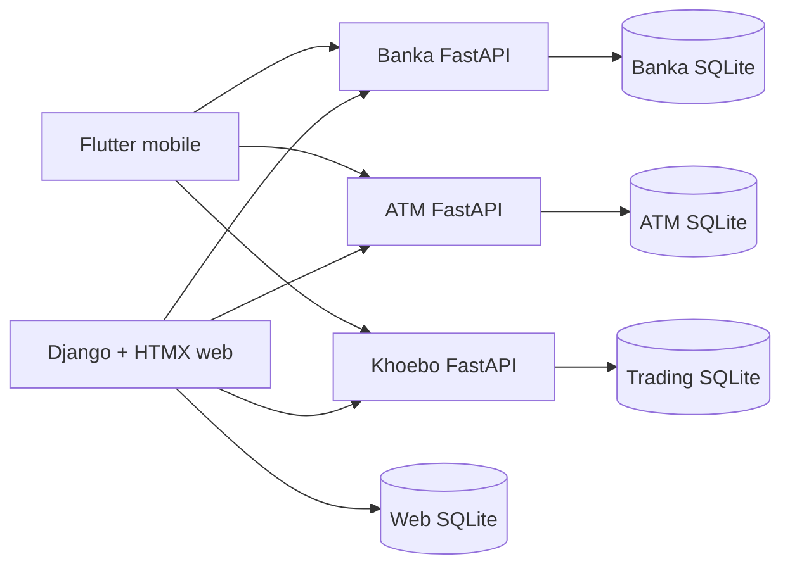

# Technical Design and Decisions

## 1. Architecture



The web service owns presentation, session state, customer-facing demo ledger records, and Django authentication. Each FastAPI service owns a bounded domain and its own SQLite file. Services communicate through HTTP; they do not share tables.

## 2. Repository layout

- `services/web`: Django project, HTMX templates, authenticated user workspace, web SQLite.
- `services/banka-api`: accounts, payments, pockets, card-control API, banking SQLite.
- `services/atm-api`: terminals, withdrawals, deposits, cardless cash API, ATM SQLite.
- `services/trading-api`: markets, orders, forex wallets, conversions, BOP API, trading SQLite.
- `mobile`: Flutter client starter.
- `docker-compose.yml`: local orchestration and health dependencies.

## 3. Technology decisions

| Area | Decision | Reason |
| --- | --- | --- |
| Web | Django 6.x target | Mature auth, ORM, migrations, templates, security middleware |
| Web interaction | HTMX | Server-rendered interactions without a second SPA state model |
| APIs | FastAPI | Typed request validation, OpenAPI docs, lightweight domain services |
| Mobile | Flutter | One client codebase for Android and iOS |
| Persistence | SQLite per service for development | Simple local setup and clear ownership; production requires managed relational databases |
| Runtime | Python 3.13 target | Current supported runtime for the 2026 baseline |
| Containers | Docker Compose | Reproducible local service topology and health ordering |
| Styling | CSS variables and server templates | Keeps the current editorial KHOEBO visual system small and portable |

The local machine currently verifies the web service with Django 5.2.17; Docker requirements target Django 6.x. The version gap must be resolved in the CI image before production certification.

## 4. Service API contracts

### Banka API, port 8001

- `GET /health`
- `GET /v1/accounts/{account_id}`
- `POST /v1/transfers`
- `POST /v1/payments/instant`
- `POST /v1/pockets`
- `GET /v1/pockets/{account_id}`
- `POST /v1/cards/{card_id}/control`
- OpenAPI: `/docs`

The Django ATM simulator is a multi-step session flow (service, account, amount, recipient/reference, review, approval). It creates the user-scoped cash movement and receipt only after explicit approval; the FastAPI ATM API remains the future hardware/switch boundary.

### ATM API, port 8002

- `GET /health`
- `GET /v1/terminals/{terminal_id}`
- `POST /v1/withdrawals`
- `POST /v1/cardless-withdrawals`
- `POST /v1/deposits`
- OpenAPI: `/docs`

### Khoebo API, port 8003

- `GET /health`
- `GET /v1/markets`
- `POST /v1/orders`
- `GET /v1/forex/wallets/{account_id}`
- `POST /v1/forex/conversions`
- `POST /v1/forex/bop-declarations`
- OpenAPI: `/docs`

## 5. Request and mutation rules

- JSON API payloads are validated with Pydantic.
- Django HTML mutations use POST and CSRF tokens.
- User records are scoped through `request.user`.
- Money is stored as decimal values, never binary floating point in persistent models.
- Every successful mutation returns a stable identifier or reference.
- Production APIs must add idempotency keys to payments, cash, and order mutations.

## 6. Security decisions

Implemented foundation:

- Django authentication and sessions.
- CSRF middleware and form tokens.
- Protected routes with `login_required`.
- Per-user query filtering on web records.
- Container secrets can be supplied through environment variables.

Required before production:

- Replace development secret keys and demo credentials.
- Add MFA, biometric platform APIs, device binding, and session expiry.
- Add API authentication and service-to-service identity.
- Encrypt secrets and sensitive data at rest and in transit.
- Do not store raw card data, PINs, CVVs, or card tokens in application logs.
- Add rate limiting, fraud rules, lockout, audit events, and alerting.
- Add KYC/AML and exchange-control review workflows.

## 7. Deployment

Development:

```powershell
cd KHOEBO_DIGITAL_BANKING
docker compose up --build
```

The web container is exposed on port 8000. When Docker is unavailable, the local Django fallback uses port 8010 and FastAPI services use 8001-8003.

Production changes required:

- Replace SQLite with managed databases.
- Run behind a reverse proxy and TLS.
- Use Gunicorn/Uvicorn workers rather than `runserver`.
- Add migrations as a release step.
- Add centralized logs, metrics, traces, backups, and restore drills.
- Add CI, dependency scanning, image scanning, and secret scanning.
